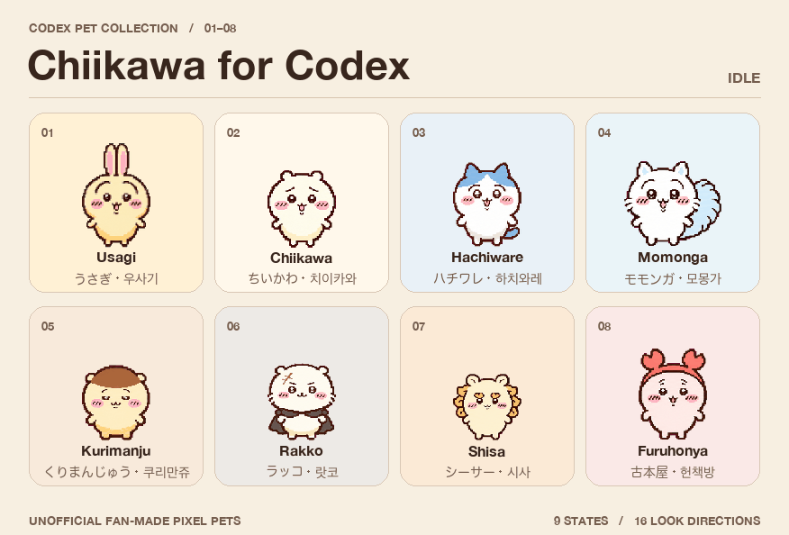

# Codex 用ちいかわペット

[English](README.md) · **日本語** · [한국어](README.ko.md)

Codex デスクトップアプリで使える、ファン制作のドット絵ペット8体です。各ペットに9種類のアニメーションと16方向の視線を収録しています。

## ダウンロード

[日本語版](https://github.com/tac0de/codex-pet-tools/releases/download/chiikawa-v1.0.0/chiikawa-codex-pets-ja.zip) · [英語版](https://github.com/tac0de/codex-pet-tools/releases/download/chiikawa-v1.0.0/chiikawa-codex-pets-en.zip) · [韓国語版](https://github.com/tac0de/codex-pet-tools/releases/download/chiikawa-v1.0.0/chiikawa-codex-pets-ko.zip)

どの ZIP にも同じ8体が入っています。Codex に表示されるペットの名前と説明に合わせて、言語を1つ選んでください。

## インストール

1. ZIP をダウンロードして展開します。
2. Codex のペットフォルダを開きます。既定の場所は macOS では `~/.codex/pets/`、Windows では `%USERPROFILE%\.codex\pets\` です。`CODEX_HOME` を設定している場合は、その下の `pets` フォルダを使います。フォルダがなければ作成してください。
3. 使いたいペットの**個別フォルダ**をコピーします。ちいかわの場合、`pets/chiikawa/pet.json` と `pets/chiikawa/spritesheet.webp` があることを確認します。後で表示言語を変えるには、該当するペットの `pet.json` を別の言語版のものに差し替えてください。
4. 一覧に出ない場合は Codex を再起動します。**設定 → 外観 → ペット**（英語 UI では **Settings → Appearance → Pets**）から使いたいペットを選びます。

インストールには ZIP の中身だけで十分です。英語版は [`pets/`](pets/) から1体ずつコピーできます。[Python ツールの説明（英語）](TOOLS.md)

## 収録キャラクター

うさぎ、ちいかわ、ハチワレ、モモンガ、くりまんじゅう、ラッコ、シーサー、古本屋

## クレジット

非公式のファン作品です。『ちいかわ』と登場キャラクターはナガノ氏の作品です（©nagano）。[MIT ライセンス](LICENSE)は Python ツールに適用されます。キャラクターの権利は各権利者に帰属します。[公式クレジット](https://spiralcute.com/characters/chiikawa/)
