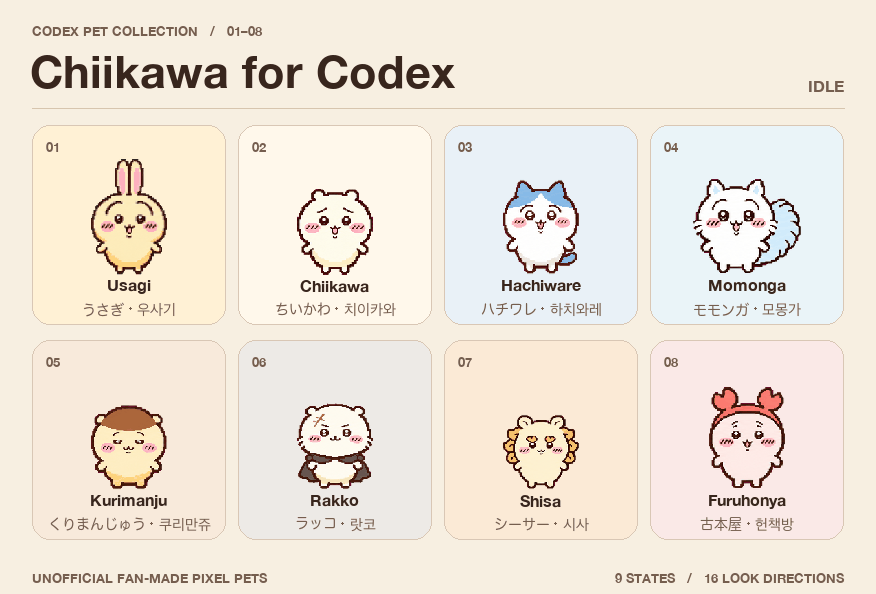

# Codex용 먼작귀 펫

[English](README.md) · [日本語](README.ja.md) · **한국어**

Codex 데스크톱 앱에서 쓰는 팬메이드 먼작귀 픽셀 펫 8종입니다. 펫마다 기본 동작 9종과 시선 16방향이 들어 있습니다.

## 다운로드

[한국어 팩](https://github.com/tac0de/codex-pet-tools/releases/download/chiikawa-v1.0.0/chiikawa-codex-pets-ko.zip) · [영어 팩](https://github.com/tac0de/codex-pet-tools/releases/download/chiikawa-v1.0.0/chiikawa-codex-pets-en.zip) · [일본어 팩](https://github.com/tac0de/codex-pet-tools/releases/download/chiikawa-v1.0.0/chiikawa-codex-pets-ja.zip)

세 ZIP에 같은 펫 8종이 들어 있습니다. Codex에 표시할 펫 이름과 설명의 언어에 맞춰 하나를 받으세요.

## Codex에 설치하기

1. ZIP을 내려받아 압축을 풉니다.
2. Codex 펫 폴더를 엽니다. 기본 위치는 macOS에서 `~/.codex/pets/`, Windows에서 `%USERPROFILE%\.codex\pets\`입니다. `CODEX_HOME`을 설정했다면 그 아래의 `pets` 폴더를 사용합니다. 폴더가 없으면 만듭니다.
3. 사용할 펫의 **개별 폴더**를 복사합니다. 치이카와를 복사했다면 `pets/chiikawa/pet.json`과 `pets/chiikawa/spritesheet.webp`가 있어야 합니다. 나중에 표시 언어를 바꾸려면 해당 펫의 `pet.json`을 원하는 언어 팩의 파일로 교체하세요.
4. 목록이 갱신되지 않으면 Codex를 다시 시작합니다. **설정 → 외관 → 펫**(영어 UI는 **Settings → Appearance → Pets**)에서 원하는 펫을 선택합니다.

압축 파일만으로 설치할 수 있습니다. 영어판은 [`pets/`](pets/)에서 한 종씩 복사할 수도 있습니다. [Python 도구 사용법(영어)](TOOLS.md)

## 포함된 펫

우사기, 치이카와, 하치와레, 모몽가, 쿠리만쥬, 랏코, 시사, 헌책방

## 크레딧

비공식 팬 프로젝트입니다. 먼작귀와 등장 캐릭터는 나가노의 작품입니다(©nagano). [MIT 라이선스](LICENSE)는 Python 도구에 적용됩니다. 캐릭터 권리는 각 권리자에게 있습니다. [공식 권리 표기](https://spiralcute.com/characters/chiikawa/)
