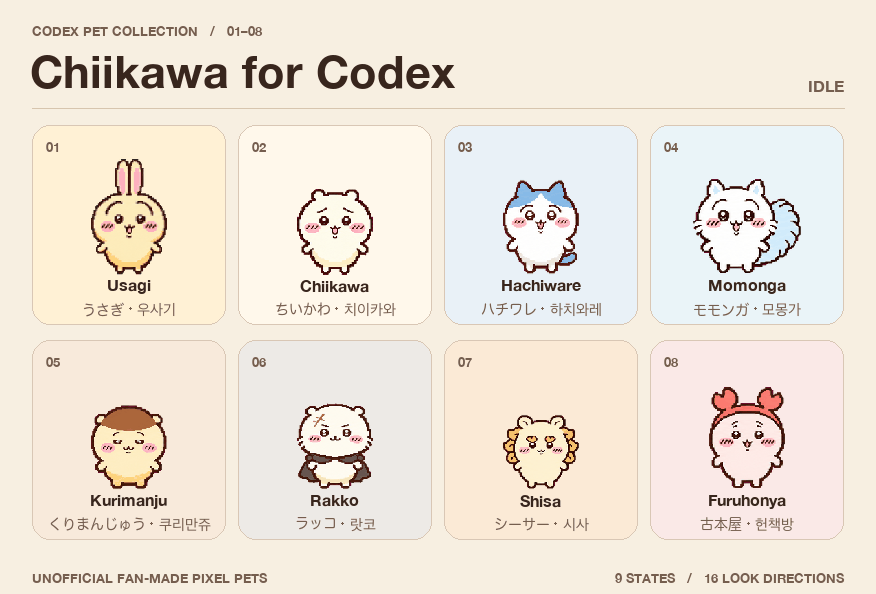

# Chiikawa Pets for Codex

**English** · [日本語](README.ja.md) · [한국어](README.ko.md)

Eight fan-made pixel pets for the Codex desktop app. Each pet includes nine animation states and 16 gaze directions.

## Download

| Pet names and descriptions in Codex | Install-ready ZIP |
| --- | --- |
| English | [Download English pack](https://github.com/tac0de/codex-pet-tools/releases/download/chiikawa-v1.0.0/chiikawa-codex-pets-en.zip) |
| 日本語 | [日本語版をダウンロード](https://github.com/tac0de/codex-pet-tools/releases/download/chiikawa-v1.0.0/chiikawa-codex-pets-ja.zip) |
| 한국어 | [한국어 팩 다운로드](https://github.com/tac0de/codex-pet-tools/releases/download/chiikawa-v1.0.0/chiikawa-codex-pets-ko.zip) |

All three packs contain the same eight pets. Choose one language. You can also copy an individual pet from [`pets/`](pets/) for the English version.

## Install in Codex

1. Download and extract a ZIP.
2. Open your Codex pets folder. On macOS it defaults to `~/.codex/pets/`. On Windows it defaults to `%USERPROFILE%\.codex\pets\`. If you set `CODEX_HOME`, use its `pets` subfolder. Create the folder if needed.
3. Copy the **individual pet folders** you want into that folder. For example, you should end up with `pets/chiikawa/pet.json` and `pets/chiikawa/spritesheet.webp`. To switch languages later, replace the matching pet's `pet.json` with the one from the language pack you want.
4. Restart Codex if the list has not refreshed. Go to **Settings → Appearance → Pets** and select the pet.

The ZIPs include everything needed for manual installation. For the sprite format and Python utilities, see the [Codex pet contract](https://github.com/openai/skills/blob/main/skills/.curated/hatch-pet/references/codex-pet-contract.md) and [tool documentation](TOOLS.md).

## Characters

| English | 日本語 | 한국어 |
| --- | --- | --- |
| Usagi | うさぎ | 우사기 |
| Chiikawa | ちいかわ | 치이카와 |
| Hachiware | ハチワレ | 하치와레 |
| Momonga | モモンガ | 모몽가 |
| Kurimanju | くりまんじゅう | 쿠리만쥬 |
| Rakko | ラッコ | 랏코 |
| Shisa | シーサー | 시사 |
| Furuhonya | 古本屋 | 헌책방 |

## Credits

Unofficial fan project. Chiikawa and its characters are by Nagano (©nagano). The [MIT License](LICENSE) covers the Python tools. Character rights remain with their respective rights holders. [Official character credits](https://spiralcute.com/characters/chiikawa/)
